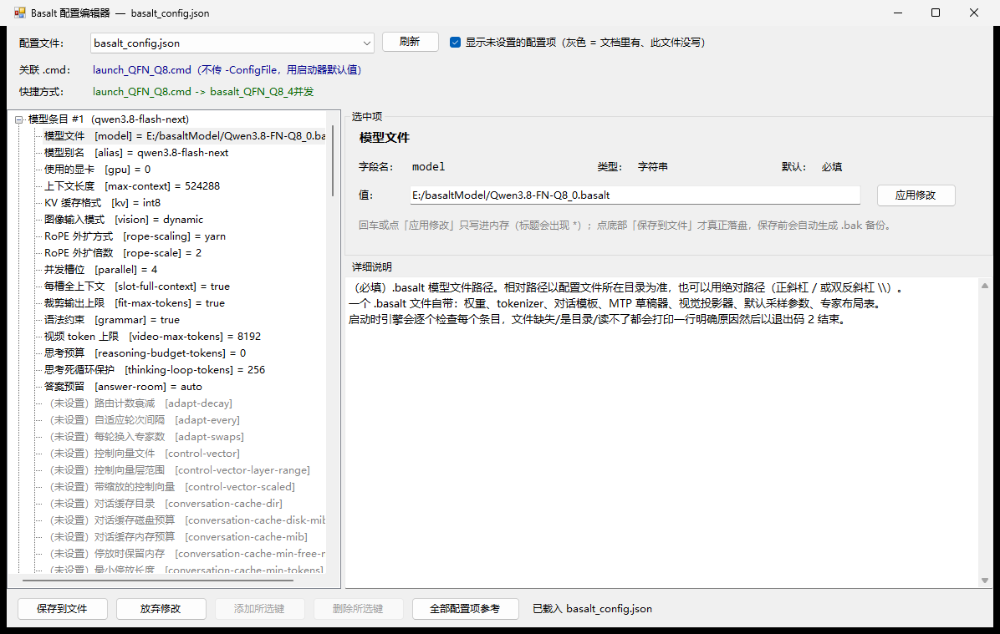

# Basalt 配置编辑器（BasaltConfigTool）

给 [Basalt](https://github.com/jesdga95/basalt) 推理引擎用的 **`basalt_config.json` 图形化编辑器**。
单文件、免安装、全中文，双击就能用。

- 把配置里 **100 个键**全部做成中文树，每个键都有中文名、类型、默认值、可选值和一段详细说明
- 打开就是引擎真实读到的那份配置，不是另存的副本
- 保存时保留你原本写的顺序、缩进和空行，只改动你改过的那几行
- 顺带告诉你：**这份配置是被哪个 `.cmd` 启动的，桌面上哪个快捷方式对应它**



---

## 目录

- [一、这个工具解决什么问题](#一这个工具解决什么问题)
- [二、系统要求](#二系统要求)
- [三、下载后三步就能用](#三下载后三步就能用)
- [四、界面详解](#四界面详解)
- [五、保存的时候到底发生了什么](#五保存的时候到底发生了什么)
- [六、关联视图：哪份配置被谁用](#六关联视图哪份配置被谁用)
- [七、字段参考](#七字段参考)
- [八、三套实测可用的配置](#八三套实测可用的配置)
- [九、常见问题](#九常见问题)
- [十、从源码编译](#十从源码编译)
- [十一、仓库结构](#十一仓库结构)
- [十二、已知限制](#十二已知限制)
- [十三、许可](#十三许可)

---

## 一、这个工具解决什么问题

Basalt 的配置文件是纯 JSON，手改有三个很疼的地方：

1. **字段名没有提示。** 100 个键散在 `docs/configuration/*.md` 里，写错一个字母，
   引擎启动时只给你一行不知道在说哪个键的报错。
2. **哪些键能用、值能填什么，只能翻文档。**
   比如 `ple-io` 只有 `direct` / `ram` 两个值，`kv` 只有 `f16` / `q8_0` / `int8`，
   填别的会直接启动失败。
3. **看不出哪份配置是"真的在用"。**
   目录里躺着七八个 `basalt_config*.json`，只有 `.cmd` 里写了 `-ConfigFile` 的那个才会被读到；
   还有的 `.cmd` 干脆不写，走启动器的默认值。改错了文件，怎么重启都没变化。

这个工具就是针对这三点做的：**中文字段树 + 每个键的说明 + 从 `.cmd`/`.lnk` 反推关联关系。**

---

## 二、系统要求

| 项目 | 要求 |
| --- | --- |
| 系统 | Windows 7 SP1 及以上，64 位 |
| 运行时 | .NET Framework 4.8（Windows 10 1809 以后、Windows 11 全部自带，**不需要安装任何东西**） |
| 屏幕 | 建议 1280×720 以上（程序已声明 DPI 感知，高分屏不会糊） |
| 权限 | 普通用户即可；只有保存时才需要对配置目录有写权限 |

> 程序是 `anycpu` 编译的单个 `.exe`，**约 65 KB，没有任何依赖文件**，复制到哪里都能跑。

---

## 三、下载后三步就能用

### 第 1 步：下载

到本仓库右侧的 **Releases** 页面，或者在仓库里直接打开 `release/BasaltConfigTool.exe`，
点 **Download** 存下来。

### 第 2 步：放进 Basalt 目录

把 `BasaltConfigTool.exe` 复制到 **Basalt 所在的那个目录**，也就是
`basalt.exe`、`basalt_config.json`、`launch_*.cmd` 一起待着的地方，例如：

```
D:\basalt-0.3.3-windows-x64\
├── basalt.exe
├── basalt_config.json          ← 主配置
├── basalt_config_8c.json
├── launch_QFN_Q8.cmd
├── launch_8c.cmd
├── scripts\start_basalt.ps1
└── BasaltConfigTool.exe        ← 放这里
```

> **为什么一定要放这个目录？**
> 程序启动时会自动扫描**自己所在目录**里的所有 `*.json`，并在这个目录里找 `*.cmd`。
> 放到别处它就只能空着手启动。

### 第 3 步：双击运行

双击 `BasaltConfigTool.exe`，它会：

1. 列出同目录下所有 `*.json`，默认选中 `basalt_config.json`
2. 载入这份配置，左边出现中文树
3. 右边第一行就告诉你：**这份配置被哪个 `.cmd` 用、对应桌面哪个快捷方式**

改完值 → 点右下角 **「保存到文件」** → 重启 Basalt 生效。

### 也可以从命令行指定目录

```cmd
BasaltConfigTool.exe "D:\basalt-0.3.3-windows-x64"
```

传任意一个存在的目录，程序就改成在**那个目录**里找配置。

---

## 四、界面详解

界面分五块：

```
┌─────────────────────────────────────────────────────────────────────┐
│ 配置文件：[ basalt_config.json ▼ ]  [刷新]                           │  ← 顶部
│ 关联 .cmd：launch_QFN_Q8.cmd                                        │
│ 快捷方式：basalt_QFN_Q8_4并发.lnk                                    │
├──────────────────────┬──────────────────────────────────────────────┤
│ ▼ 模型条目 #0         │  字段名：ple-io                              │
│   ├ model            │  类型：枚举    默认：direct                   │  ← 右侧编辑区
│   ├ alias            │  值：[ ram ▼ ]                                │
│   ├ parallel         │  ┌────────────────────────────────────────┐  │
│   └ max-context      │  │ 详细说明                                │  │
│ ▼ 引擎设置 (engine)   │  │ ...                                    │  │
│   ├ ple-io           │  └────────────────────────────────────────┘  │
│   ├ pool-workers     │                                              │
│   └ spec             │                                              │
│ ▼ 服务器设置 (server) │                                              │
│   ├ host             │                                              │
│   └ port             │                                              │
├──────────────────────┴──────────────────────────────────────────────┤
│ [添加所选键] [删除所选键] [全部配置项参考]    [保存到文件] [放弃修改]  │  ← 底部
└─────────────────────────────────────────────────────────────────────┘
```

### 4.1 顶部：选文件 + 看关联

- **配置文件下拉框** — 同目录所有 `*.json`。切换时如果有未保存的修改，会先问你。
- **刷新** — 重新扫描目录（你在外面新建了 `.json` 或 `.cmd` 之后点一下）。
- **`显示未设置的配置项`** 勾选框 — 见下面 4.2。
- **关联 `.cmd`** — 哪几个启动脚本会读到这份配置：
  - `launch_QFN_Q8.cmd` 这种是脚本里写了 `-ConfigFile basalt_config.json`，直接命中
  - 后面跟 `（不传 -ConfigFile，用启动器默认值）` 的，说明脚本里根本没写参数，
    靠 `scripts\start_basalt.ps1` 的默认值兜底 —— 这种情况 **改文件名就会失效**，工具专门标出来
- **快捷方式** — 桌面上（含子目录）哪些 `.lnk` 指向上面那些 `.cmd`。
  如果只是**文件名相同但放在别的目录**，会标 `(同名目标)` 提醒你别搞混，
  因为这种快捷方式点开跑的是**另一个位置**的脚本。

### 4.2 左边的树

三段，对应配置文件的三个部分：

| 树节点 | 对应 JSON | 说明 |
| --- | --- | --- |
| **模型条目 #0 / #1 / …** | `models[]` 数组的每一项 | 一个条目 = 一个可被 API 请求的模型 |
| **引擎设置** | 顶层 `engine` 对象 | 引擎 flag，对 models 里所有条目生效 |
| **服务器设置** | 顶层 `server` 对象 | 监听地址、端口、跨域、日志等 |

**灰色 = 文档里有、这份文件没写。** 勾上 `显示未设置的配置项` 就能看到全部 100 个键：
黑色的是配置文件里真实存在的，灰色的是可以加但当前没写的。
选中一个灰色的键，点底部 **「添加所选键」** 就会按默认值插进去。

**黑字 = 这份文件里真的写了。** 反之，只在文档里存在的键不会凭空出现在你的文件里。

节点后面的小字：

- `（未收录的键）` — 你文件里有这个键，但 Basalt 0.3.3 的文档里查不到。**小心**，
  引擎大概率不认识它并拒绝启动。
- `（未设置）` — 灰节点，文件里没有。

### 4.3 右边的编辑区

选中一个键之后，从上到下：

- **字段名 / 类型 / 默认** — 只读信息
- **可选** — 枚举类型的合法取值
- **值** — 按类型自动换成合适的控件：
  - `switch` → 一个 `开启（true）` 勾选框
  - `enum` → 下拉框，**只能选，不能乱填**
  - `integer` / `number` → 输入框，输入时实时校验，填 `4 个` 这种会立刻提示
  - `string` → 输入框
  - `string-list` → 输入框，用逗号或换行分隔
- **应用修改** — 或直接按回车

> ⚠️ **一定要理解这一点**：回车或点「应用修改」**只是写进内存**，
> 标题栏会多出一个 `*`。真正落盘要点**右下角的「保存到文件」**。

- **详细说明** — 这个键干什么用、填多少合适、写错了会怎样。
  内容全部抄自 Basalt 0.3.3 官方文档（`docs/configuration/*.md`），并补上了实测结论。

### 4.4 底部按钮

| 按钮 | 作用 |
| --- | --- |
| **添加所选键** | 把灰色（未设置）的键按默认值插进配置文件 |
| **删除所选键** | 从文件里删掉这个键，回到引擎默认值。`model` 不允许删 |
| **全部配置项参考** | 弹出完整表格：段 / 字段名 / 中文名 / 类型 / 默认，可排序、可搜索 |
| **保存到文件** | 真正写盘，**自动生成 `.bak` 备份** |
| **放弃修改** | 丢掉内存里的改动，重新从磁盘读 |

---

## 五、保存的时候到底发生了什么

保存不是简单地把内存里的对象序列化回去，而是：

1. **先做一轮校验** —— 缺 `models` 数组、类型不对、枚举值不合法、
   键名文档里没有、写了 `api-key`（引擎禁止），这些都会先弹窗列出来让你决定要不要继续
2. **自动备份** —— 覆盖前先把原文件写成 `basalt_config.json.bak`
3. **保留排版** —— 键的顺序、两空格缩进、字段之间的空行，都按你原文件的样子还回去。
   只有你改过的那几行会变
4. **写不进去就中止** —— 生成的文本会**重新解析一遍**再比对结构。
   万一解析失败（理论上不该发生），会提示 `内部错误` 并且**不写盘**，绝不给你留下半截文件

所以：**放心改，最坏情况是恢复 `.bak`。**

---

## 六、关联视图：哪份配置被谁用

这是本工具跟"随便一个 JSON 编辑器"最大的区别。

### 怎么判断的

1. 在**程序所在目录**里找所有 `*.cmd`
2. 用正则找脚本里的 `-ConfigFile <名字>` 和 `--config <名字>`，比对文件名
3. 如果某个 `.cmd` 调用了 `start_basalt.ps1` 但**没传**任何配置参数，
   就认为它读的是启动器默认的 `basalt_config.json`
4. 到**桌面（含所有子目录）**扫描所有 `*.lnk`，
   用 `WScript.Shell` 读出它的 `TargetPath`，跟第 2、3 步找到的 `.cmd` 全路径比对

### 典型用法

想把"4 并发"换成"8 并发"：

1. 下拉框选 `basalt_config.json`，确认「关联 .cmd」是 `launch_QFN_Q8.cmd`
2. 下拉框选 `basalt_config_8c.json`，确认关联的是 `launch_8c.cmd`
3. 桌面上点对应的两个快捷方式分别测试

**如果某份配置的「关联 .cmd」是空的**，说明没有任何启动脚本会读它 ——
你改它不会有任何效果，先去找对应的 `.cmd` 或新建一个。

---

## 七、字段参考

下面是三段里最关键的键。**完整的 100 个键**在程序里点「全部配置项参考」就能查到，
每个都有中文说明。

### 7.1 `models[]` 条目：模型身份

| 键 | 中文名 | 说明 |
| --- | --- | --- |
| `model` | 模型文件 | **必填**。`.basalt` 文件路径，相对路径以配置文件所在目录为准 |
| `alias` | 模型别名 | API 上报的模型名。两个条目用同一个别名 → 启动失败 |
| `gpu` | 使用的显卡 | `"0"` / `"0,1"` / `"auto"`。第一张是主卡，后面每张成为专家层（最多三张） |
| `parallel` | 并发槽位 | `1`–`8`。同时解码的请求数，超出的排队 |
| `slot-full-context` | 每槽全上下文 | 开着 = 每槽各拿完整 `max-context`，代价是 KV 缓存 ×N |
| `max-context` | 上下文长度 | 单次请求能看到的最大 token 数 |
| `kv` | KV 缓存格式 | `f16` / `q8_0` / `int8` |
| `vision` | 图像输入模式 | 控制图片输入；`video-max-tokens` 单独控制视频 |
| `spec` | 投机解码窗口 | 草稿器一次猜几个 token。**实测 8 最优**，4 会掉 10%，12 没有额外收益 |
| `temperature` / `top-p` / `top-k` / `min-p` | 采样默认值 | 请求里没给参数时用这些 |

### 7.2 `engine` 段：引擎级 flag

对 `models[]` 里所有条目生效；条目里写了同名键则条目优先。

**内存与显存（最重要的一组）**

| 键 | 中文名 | 说明 |
| --- | --- | --- |
| `ple-io` | n-gram 表 I/O 方式 | `direct`（直接读 SSD）/ `ram`（先读进内存）。**实测 `ram` 把预填充从约 2400 提到约 9600 tok/s，约 4 倍**，代价是多占约 50 GiB 内存、启动慢 30–45 秒 |
| `expert-cache` | 显存专家槽数 | 显存里能同时放多少个专家 |
| `vram-reserve-mib` | 显存预留 | 给驱动和其他程序留的显存，别填 0 |
| `ram-reserve-mib` | 内存预留 | 系统的内存下限，正常情况不会触发 |
| `resident-experts` / `resident-budget-gib` | 专家常驻内存 | 是否把专家留一份在内存里、预算多少 |
| `mmap-experts` | 专家用文件映射 | 让系统按需调页，省内存但慢 |
| `vram-elastic` | 显存弹性借出 | 允许 KV 借走专家缓存的空间 |

**预填充与 CPU 参与**

| 键 | 中文名 | 说明 |
| --- | --- | --- |
| `prefill` | 预填充块大小 | 一次算多少 token。留空/auto 让引擎自己定 |
| `prefill-cpu-share` | 预填充 CPU 占比 | **实测填 0 和填别的没差别**，建议 0（全给 GPU） |
| `pool-workers` | CPU 专家池线程数 | **实测 4 / 15 / 24 都在噪声范围内**，填 CPU 物理核数附近即可 |
| `short-read` | 短提示走解码窗口 | 短 prompt 跳过预填充 |

**缓存（决定多轮对话有多快）**

| 键 | 中文名 | 说明 |
| --- | --- | --- |
| `conversation-cache-mib` | 对话缓存内存预算 | 缓存已算好的会话状态 |
| `conversation-cache-slots` | 对话缓存槽位数 | 能同时记住几个会话 |
| `conversation-cache-min-tokens` | 最小停放长度 | 太短的对话不值得缓存 |
| `conversation-cache-disk-mib` | 对话缓存磁盘预算 | 溢出到磁盘的部分 |
| `prompt-cache` / `prompt-cache-every` | 提示检查点 | 长系统提示的复用粒度 |

**有损开关（默认全关，别乱开）**

`relaxed-drafting`、`route-tail-skip`、`route-prior` 这三个会**降低输出质量**换速度。
默认全 `false`。开启后投机解码不再保证和不开时输出完全一致。

### 7.3 `server` 段

| 键 | 中文名 | 说明 |
| --- | --- | --- |
| `host` | 监听地址 | `127.0.0.1` 只本机；`0.0.0.0` 整个局域网可访问（**注意安全**） |
| `port` | 端口 | 默认 `8000` |
| `allowed-host` | 允许的 Host 名 | 反向代理后面才需要填 |
| `cors-origin` | 允许的跨域来源 | 浏览器直接调 API 时填 |
| `api-key` | — | **不能写在这里。** Basalt 设计上只接受命令行 `--api-key`，写进配置会被拒绝启动 |

---

## 八、三套实测可用的配置

以下都是在本机（单卡 96 GB 显存 + 大内存）实测过的组合，
可以当作起点，再按自己机器改。**注意 `max-context` 和 `rope-scaling` 要配套。**

### 8.1 4 并发 / 512K 上下文（日常推荐）

| 键 | 值 |
| --- | --- |
| `parallel` | `4` |
| `max-context` | `524288` |
| `rope-scaling` / `rope-scale` | `yarn` / `2` |
| `ple-io` | `ram` |
| `prefill` | `49152` |
| `prefill-cpu-share` | `0` |
| `pool-workers` | `15` |
| `spec` | `8` |
| `conversation-cache-mib` | `49152` |
| `conversation-cache-slots` | `32` |
| `conversation-cache-disk-mib` | `20480` |

### 8.2 8 并发

跟 8.1 只差一行：`parallel: 8`。

**实测数据**（`/slots` 采样，每请求 700 token）：

| 并发 | 聚合吞吐 | 相对单流 | 单请求速度 |
| --- | --- | --- | --- |
| 1 | 206 tok/s | 1.00× | 206 tok/s |
| 4 | 347 tok/s | 1.68× | 约 87 tok/s |
| 8 | 434 tok/s | 2.11× | 约 54 tok/s |

也就是说：**8 并发聚合快一倍，但每个请求慢到 1/4。** 要吞吐选 8，要单条速度选 1。

### 8.3 256K 单流（官方推荐尺寸，不用 RoPE 外扩）

| 键 | 值 |
| --- | --- |
| `parallel` | `1` |
| `max-context` | `262144` |
| `rope-scaling` | 不写（用原生长度） |
| `ple-io` | `ram` |
| `pool-workers` | `15` |
| `vram-reserve-mib` | `1024` |
| `conversation-cache-disk-mib` | `32768` |

`262144` 是模型原生长度，不外扩就不用承担 YaRN 带来的质量损失，是最稳的一套。

> **改了配置必须重启 Basalt 才生效**，而且重启前确认旧进程真的退干净了：
> 这个引擎一套配置会锁住几十 GiB 内存，两个实例同时起会直接报
> `RAM ran out loading`。

---

## 九、常见问题

**Q：打开后说"这个目录里没有 *.json 配置文件"。**
程序扫的是**自己所在的目录**。把 exe 挪到 Basalt 目录，或者用
`BasaltConfigTool.exe <目录>` 指定。

**Q：改了值、也按回车了，重启引擎怎么没变化？**
回车只是写进内存，标题栏有 `*` 就说明还没落盘。要点**右下角「保存到文件」**。

**Q：保存后引擎起不来了，报了一行看不懂的错。**
同目录下有 `basalt_config.json.bak`，改回去就行。或者打开工具看哪个键标着
`（未收录的键）` —— 那基本就是元凶。

**Q：`（未收录的键）` 到底能不能留？**
`engine` 段里的键，引擎会拿二进制自带的 flag 表逐个校验：
**完全不认识的名字 → 直接启动失败**；模型没有的 flag → 跳过并打一行日志。
所以看到这个标记，先确认拼写，拿不准就删掉。

**Q：为什么 `api-key` 不能填？**
Basalt 设计上只从命令行收 `--api-key`，写进配置文件会被明确拒绝。
启动脚本 `scripts\start_basalt.ps1` 会从 `.api_key` 文件读出来再传进去。

**Q：`models[]` 里有灰色键，我要不要加？**
灰色只代表"文档里有、你没写"。不写就是用引擎默认值，**大多数情况不需要加**。
只有你想改默认行为时才加。

**Q：工具会不会把我的注释弄丢？**
JSON 本身不支持注释，Basalt 的配置文件里也没有注释。
工具保留的是**键的顺序、缩进和空行**，这三样能保住你原有的文件结构。

**Q：能同时开两个窗口改两份配置吗？**
技术上可以，但**别对同一个文件开两个窗口** —— 后保存的会覆盖先保存的。
需要对比两份配置时，分别打开不同的文件。

---

## 十、从源码编译

### 依赖

只需要 **.NET Framework 4.8**（Windows 自带）+ 一个 C# 编译器。二选一：

- **Visual Studio 2022 Build Tools** 的 Roslyn：`...\MSBuild\Current\Bin\Roslyn\csc.exe`
- **Windows 自带的旧版 csc**：`C:\Windows\Microsoft.NET\Framework64\v4.0.30319\csc.exe`

不需要 NuGet、不需要 `.csproj`、不需要装 .NET SDK。

### 编译

```cmd
git clone https://github.com/<你的用户名>/BasaltConfigTool.git
cd BasaltConfigTool
build.cmd
```

产物在 `release\BasaltConfigTool.exe`。脚本会自动按顺序在两种编译器里找可用的那个。

### 无界面自检

不想开窗口、只想验证解析和关联扫描是否正常：

```cmd
release\BasaltConfigTool.exe --selftest "D:\basalt-0.3.3-windows-x64"
```

结果写到 `%TEMP%\BasaltConfigTool-selftest.txt`，内容包括：

- 找到的 `*.json` 列表
- 每份配置的关联 `.cmd` / `.lnk`
- **JSON 往返测试**：解析 → 序列化 → 再解析 → 逐项比对结构
- **排版保真度**：跟原文件逐行比，报告差了几行
- 配置里每个键是否都在文档目录里收录过

退出码 `0` = 全部通过，`1` = 有失败项。

---

## 十一、仓库结构

```
BasaltConfigTool/
├── README.md                    本文件
├── LICENSE                      许可
├── build.cmd                    一键编译
├── src/
│   ├── Program.cs               入口、DPI、异常兜底、--selftest
│   ├── Json.cs                  保序 JSON 解析 / 序列化（保留空行信息）
│   ├── Catalog.cs               100 个配置键的中文说明目录
│   ├── Assoc.cs                 从 .cmd / .lnk 反推配置关联
│   └── MainForm.cs              主窗口
├── release/
│   └── BasaltConfigTool.exe     编译好的成品，可直接用
└── docs/
    └── screenshot.png           界面截图
```

### 几个实现上的取舍

- **为什么自己写 JSON 解析器？**
  `System.Text.Json` 在 .NET Framework 4.8 上要额外装包；
  `JavaScriptSerializer` 会打乱键顺序、丢掉空行信息，保存出来的文件跟原文完全不一样。
  自己写一个保序解析器，才能做到"只改你改过的那几行"。

- **为什么用 `WScript.Shell` 读 `.lnk`？**
  `.lnk` 是二进制格式，没有公开的 .NET API。
  COM 的 `WScript.Shell` 系统自带、免依赖，读 `TargetPath` 足够。

- **为什么是 WinForms 而不是 WPF？**
  单文件 65 KB vs 几百 KB，而且 .NET Framework 4.8 上 WinForms 的启动速度快一个数量级。

---

## 十二、已知限制

- **只针对 Basalt 0.3.3 的文档。** 引擎升级、加了新 flag，本工具不会自动认识；
  新键会显示成 `（未收录的键）`。改 `src/Catalog.cs` 加一条 `K(...)` 就能补上。
- **只扫程序所在目录（或命令行指定的那个目录）**，不会递归找子目录里的 `*.json`。
- **快捷方式只扫桌面**（含子目录），不扫开始菜单和任务栏。
- **`.cmd` 的关联是靠正则匹配文本**，如果脚本里的路径是运行时拼出来的，工具看不出来。
- **不做语义校验。** 比如 `max-context: 524288` 配 `rope-scaling` 不写，
  工具不会报错 —— 这种要引擎自己判断。
- **保存会自动生成 `.bak`**，但只保留一份，连续保存会覆盖上一次的备份。

---

## 十三、许可

见 [LICENSE](LICENSE)。简单说：随便用、随便改、随便分发，出问题自己负责。

---

**和 Basalt 的关系**：这是社区第三方工具，不是 Basalt 官方组件。
配置字段的说明来自 Basalt 0.3.3 的公开文档，实测数据来自本机单卡环境。
引擎本身的问题请提到 [jesdga95/basalt](https://github.com/jesdga95/basalt)。
